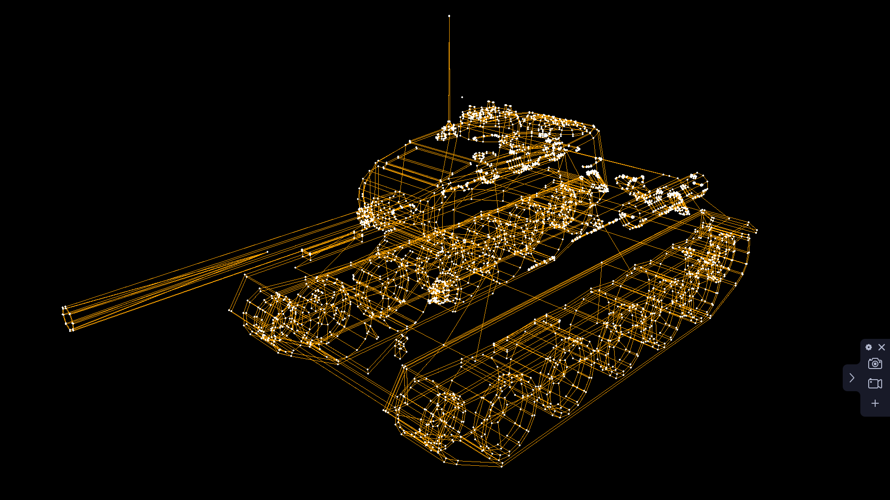

# Software 3D Engine

A pure software 3D rendering engine (object renderer) built in Python using Pygame, NumPy, and Numba.



## Features
- Pure software-based 3D projection and rasterization (no OpenGL required)
- Optimized vector and matrix transformations using NumPy and Numba JIT
- 3D camera controller (WASD movement, mouse look, rotation)
- Wavefront `.obj` 3D model parsing and rendering
- Included video walkthrough and subtitles in the [`video/`](video/) directory

## Installation & Usage

1. Install dependencies:
   ```bash
   pip install -r requirements.txt
   ```

2. Run the 3D engine:
   ```bash
   python main.py
   ```
